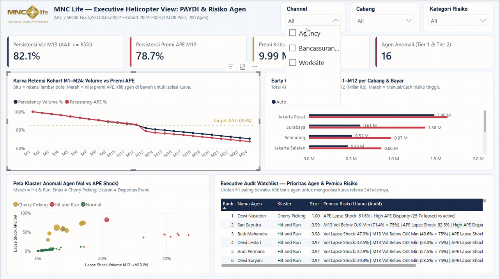

# Analisis Kohort Persistensi Polis PAYDI & Deteksi Churn Agen (Power BI Project)

Proyek analitik aktuaria dan sistem deteksi anomali perilaku agen asuransi untuk produk **PAYDI (Produk Asuransi Yang Dikaitkan dengan Investasi / Unit Link)**. Sistem ini menyajikan visualisasi tingkat eksekutif menggunakan **Microsoft Power BI Project (`.pbip`)** dengan semantic model berbasis **TMDL (Tabular Model Definition Language)** dan format pelaporan **PBIR (Power BI Enhanced Report Format)**.

Pipeline analitik didukung oleh mesin Python untuk simulasi data aktuaria realistis, rekayasa fitur multivariat, kalibrasi deteksi dua tingkat (*Two-Tier Anomaly Detection*), serta dekomposisi 4 pilar risiko yang sepenuhnya *explainable* (dapat diaudit).

Visualisasi dan tata letak laporan dirancang sesuai identitas visual korporat **PT MNC Life Assurance**, dengan kepatuhan penuh terhadap regulasi **Surat Edaran Otoritas Jasa Keuangan (SEOJK No. 5/SEOJK.05/2022)** dan standar persistensi **Asosiasi Asuransi Jiwa Indonesia (AAJI)**.

> **Catatan Kerahasiaan Data:** Seluruh data yang digunakan merupakan data sintetis terprogram yang dihasilkan oleh mesin aktuaria (`generate_data.py`). Tidak ada data rahasia nasabah riil yang diekspos. Distribusi premi, rasio persistensi, dan skenario kecurangan dirancang mendekati dinamika industri asuransi jiwa nasional.

---

## Preview Demo Interaktif Dashboard (Power BI)



---

## 1. Masalah Bisnis & Celah Moral Hazard

Dalam industri asuransi jiwa, struktur komisi tahun pertama (*First Year Commission* / FYC) dan bonus persistensi bulan ke-13 (M13) memiliki bobot finansial signifikan. Hal ini menimbulkan celah manipulasi:

1. **Titik Buta Persistensi Volume (Modus Cherry-Picking):**
   - Sebagian besar pemantauan regulasi hanya melihat rasio volume lembar polis aktif (Target AAJI $\ge 85\%$).
   - Oknum agen mempertahankan polis tiket kecil (misal premi Rp 4–8.5 juta/tahun) agar rasio volume M13 tetap tinggi (>85%), namun membiarkan polis jumbo (Rp 70–160 juta/tahun) gugur (*lapse*) begitu komisi tahun pertama diterima.
   - Dampak: Laporan volume terlihat patuh, namun terjadi kebocoran premi tahunan (*Annualized Premium Equivalent* / APE) dalam jumlah miliaran rupiah (*Leakage Gap*).

2. **Modus Hit and Run:**
   - Agen menjual polis dengan pembayaran tunai (*cash/manual*) atau talangan premi sendiri, mempertahankan status aktif selama 12 bulan pertama agar komisi FYC cair penuh, lalu membiarkan polis gugur massal pada M13 (*Lapse Shock* volume > 25%).

---

## 2. Metodologi Deteksi & 4 Pilar Risiko

Sistem menggunakan pendekatan hibrida untuk mendeteksi dan mengkuantifikasi anomali agen:

### A. Kalibrasi Kohort Penuh (Seasoned Cohort)
- Rentang kohort penerbitan: **2022-01 hingga 2023-12** (24 kohort bulanan, 12.000 polis, 200 agen).
- Seluruh polis memiliki riwayat observasi lengkap dari M1 hingga M24, menjamin keandalan pengujian M12 $\rightarrow$ M13 tanpa distorsi *right-censoring*.

### B. Deteksi Dua Tingkat (Two-Tier Detection)
- **Tier 1 (Rule-Based Substandard & Shock Filter):**
  Menangkap agen *Hit and Run* yang mengalami lonjakan lapse volume drastis ($Lapse\ Shock\ Vol > 25\%$) atau persistensi volume M13 di bawah $75\%$ dengan $Lapse\ Shock\ Vol \ge 15\%$. Bebas dari *false positive* pada agen normal yang mengalami penurunan alami secara gradual ($0\%-3\%$).
- **Tier 2 (Isolation Forest Multivariate ML):**
  Menangkap agen *Cherry-Picking* yang lolos dari filter volume Tier 1 karena persistensi volume tetap tinggi, namun memiliki disparitas premi ekstrem (*APE Disparity Ratio* tinggi) dan kebocoran APE tersembunyi.
- **Performa Evaluasi:**
  - **Top-20% Recall:** **100%** (16 dari 16 agen anomali ground-truth berada dalam peringkat 20% risiko teratas; melampaui target minimum spec $\ge 85\%$).
  - **Overall Recall:** **100%** (16/16 anomali terdeteksi).
  - **Normal False Positives in Tier 1:** **0 agen**.

### C. Dekomposisi 4 Pilar Risiko (Explainable AI / XAI)
Setiap agen diurai skor risikonya ke dalam 4 pilar yang dinormalisasi pada skala `0 - 100` beserta porsi kontribusinya (`%`):
1. **Pilar 1 - Volume Shock M12-M13 (`score_vol_shock`):** Penurunan persentase volume polis aktif antara bulan ke-12 dan bulan ke-13.
2. **Pilar 2 - APE Leakage Shock M12-M13 (`score_ape_shock`):** Penurunan persentase nilai premi APE antara bulan ke-12 dan bulan ke-13.
3. **Pilar 3 - APE Ticket Disparity (`score_ape_disparity`):** Rasio nilai premi rata-rata polis lapse terhadap polis yang tetap aktif (disparitas $> 1.5\times$ menandakan indikasi *cherry-picking*).
4. **Pilar 4 - Manual/Cash Concentration (`score_cash_ratio`):** Konsentrasi metode pembayaran manual/tunai dibandingkan auto-debit bank.

---

## 3. Arsitektur Power BI Project (`.pbip`)

Laporan dibangun dengan arsitektur modern Fabric/Power BI Desktop Developer Mode:

```text
powerbi/
├── MNC_Life_PAYDI.pbip                      # File pembuka project Power BI Desktop
├── assets/
│   ├── dashboard_demo.gif                   # Animasi demo interaktif dashboard (1280px)
│   └── mnc_life_logo.png                    # Brand logo MNC Life resolusi tinggi
├── MNC_Life_PAYDI.SemanticModel/            # Model Semantik (TMDL Formats)
│   ├── definition.pbism
│   └── definition/
│       ├── database.tmdl                    # Compatibility level 1600
│       ├── model.tmdl                       # Deklarasi tabel dan culture
│       ├── expressions.tmdl                 # Parameter DataFolderPath (portabel)
│       ├── relationships.tmdl               # Relasi skema bintang 1-to-many
│       └── tables/
│           ├── DimAgent.tmdl                # 200 agen, metrik risiko, KPI akurasi
│           ├── DimPolicy.tmdl               # 12.000 polis, issue date, APE
│           ├── FactPolicyMonthlyStatus.tmdl # 288.000 status bulanan, DAX persistensi
│           └── FactAgentRiskPillars.tmdl    # 800 baris unpivoted 4-pilar risiko
└── MNC_Life_PAYDI.Report/                   # Definisi Laporan PBIR (PBIR v2.0 / 4.0)
    ├── .platform
    ├── definition.pbir                      # Binding report ke model semantik lokal
    ├── StaticResources/
    │   ├── RegisteredResources/
    │   │   └── mnc_life_logo_1001.png       # Aset logo resmi MNC Life
    │   └── SharedResources/BaseThemes/
    │       └── Fluent2-CY26SU10.json        # Tema korporat MNC Life
    └── definition/
        ├── version.json
        ├── report.json
        └── pages/
            ├── pages.json                   # Konfigurasi halaman tunggal (Helicopter View)
            └── ReportSection01/             # Executive Helicopter View (1280x720, 13 Visual)
```

### Formula DAX Utama (Portofolio Berbobot & Distinct)

- **Active Policies:**
  ```dax
  CALCULATE(
      DISTINCTCOUNT(FactPolicyMonthlyStatus[policy_id]),
      FactPolicyMonthlyStatus[status] IN {"Active", "Grace Period"}
  )
  ```
- **Active APE (Tertimbang):**
  ```dax
  CALCULATE(
      SUM(DimPolicy[ape]),
      TREATAS(
          CALCULATETABLE(
              VALUES(FactPolicyMonthlyStatus[policy_id]),
              FactPolicyMonthlyStatus[status] IN {"Active", "Grace Period"}
          ),
          DimPolicy[policy_id]
      )
  )
  ```
- **Persistency Volume %:** `DIVIDE([Active Policies], [Initial Policies])`
- **Persistency APE %:** `DIVIDE([Active APE], [Initial APE])`
- **Leakage Gap %:** `[Persistency Volume %] - [Persistency APE %]`
- **M13 Volume vs AAJI Benchmark:** `[M13 Volume Persistency %] - 0.85`
- **M13 Leaked APE (Miliar IDR):** `DIVIDE([M13 Leaked APE (IDR)], 1000000000)`
- **Grace Period Policies (M11-M12):**
  ```dax
  CALCULATE(
      DISTINCTCOUNT(FactPolicyMonthlyStatus[policy_id]),
      FactPolicyMonthlyStatus[month_index] IN {11, 12},
      FactPolicyMonthlyStatus[status] = "Grace Period"
  )
  ```

---

## 4. Arsitektur Tampilan: Single-Page Executive Helicopter View (`1280 × 720`)

Laporan didesain menjadi **1 halaman tunggal** (*One-Page Executive Cockpit*) berkapasitas 13 visual yang langsung menyajikan gambaran utuh dalam satu layar tanpa navigasi tab:

1. **Header Korporat & 3 Global Slicers:**
   - Logo resmi PT MNC Life Assurance, judul eksekutif beserta standar regulasi (AAJI / SEOJK No. 5/SEOJK.05/2022), serta 3 Dropdown Slicer tersinkronisasi (**Channel**, **Cabang**, **Kategori Risiko**).
2. **4 North Star KPI Cards (`cardVisual` dengan Left Accent Bar & Supporting Tooltips):**
   - **Persistensi Volume M13** vs target AAJI $\ge 85\%$ (tooltip selisih benchmark).
   - **Persistensi Premi APE M13** tertimbang (tooltip `M13 Leakage Gap %` & nilai kebocoran APE dalam Miliar Rp).
   - **Premi Kritis Grace Period M11–M12** dalam Miliar Rp (tooltip jumlah polis kritis & rasio pembayaran tunai).
   - **Agen Anomali (Tier 1 & 2)** (tooltip rincian jumlah *Hit and Run*, *Cherry Picking*, dan `Top-20% Recall %`).
3. **Kurva Retensi Kohort M1–M24 (`lineChart` — Kiri Atas):**
   - Membandingkan garis retensi volume polis (`#192C4D`) vs nilai premi APE (`#D94B4B`) dari M1–M24 dengan garis konstan emas **Target AAJI (85%)**. Terhubung otomatis dengan *cross-filtering* saat salah satu agen diklik.
4. **Early Warning Grace Period M11–M12 (`clusteredBarChart` — Kanan Atas):**
   - Menggabungkan peringkat premi kritis per kantor cabang beserta komposisi metode pembayaran (`Manual/Cash` vs `Auto-Debit`) yang diurutkan dari beban premi tertinggi.
5. **Peta Klaster Anomali Agen (`scatterChart` — Kiri Bawah):**
   - Memvisualisasikan `lapse_shock_vol` vs `lapse_shock_ape` dengan ukuran gelembung `ape_disparity_ratio` dan warna per klaster (*Hit and Run* Coral Red, *Cherry Picking* Gold, *Normal* Emerald).
6. **Executive Audit Watchlist (`tableEx` — Kanan Bawah):**
   - Tabel prioritas pemeriksaan diurutkan otomatis dari peringkat risiko tertinggi (`#1`), menampilkan **Rank**, **Nama Agen**, **Klaster**, **Skor**, dan **Pemicu Risiko Utama (Audit)**.

---

## 5. Panduan Instalasi & Menjalankan Proyek

### Prasyarat
- **Python:** 3.10 atau 3.11
- **Node.js:** v20+ (untuk `@microsoft/powerbi-report-authoring-cli`)
- **Power BI Desktop:** Edisi terbaru (Mendukung Power BI Project / `.pbip`)

### Langkah Eksekusi

1. **Instalasi Dependensi Python:**
   ```bash
   pip install -r requirements.txt
   ```

2. **Jalankan Pengujian Unit Pytest:**
   ```bash
   pytest -v
   ```
   *Seluruh 20 tes unit pada logika bisnis aktuaria, deteksi anomali, dan integritas data ekspor akan diverifikasi.*

3. **Jalankan Pipeline ETL & Ekspor Data:**
   ```bash
   python export_powerbi_data.py
   ```
   *Perintah ini mengekspor 5 berkas data terstruktur ke folder `data/` dan mengekstrak logo MNC Life.*

4. **Validasi Struktur Laporan PBIR:**
   ```bash
   npx @microsoft/powerbi-report-authoring-cli validate powerbi/MNC_Life_PAYDI.Report
   ```
   *Hasil: `succeeded` dengan 0 errors dan 0 warnings.*

5. **Membuka Dashboard di Microsoft Power BI Desktop:**
   Klik dua kali pada berkas:
   ```text
   powerbi/MNC_Life_PAYDI.pbip
   ```
   atau jalankan dari PowerShell:
   ```powershell
   & "C:\Program Files\Microsoft Power BI Desktop\bin\PBIDesktop.exe" "powerbi\MNC_Life_PAYDI.pbip"
   ```
   *Power BI Desktop akan memuat model semantik TMDL dan menampilkan Single-Page Executive Helicopter View secara otomatis.*

---

## 6. Identitas Visual & Standar Desain

Mengikuti panduan merek PT MNC Life Assurance:
- **Primary Navy:** `#192C4D` (Header, Kartu Metrik Utama, Sumbu Utama)
- **Accent Gold:** `#C89B2C` (Aksen, Sorotan Kepatuhan AAJI)
- **Alert / Danger Red:** `#D94B4B` (Indikator Anomali, Hit and Run, Tingkat Kebocoran APE)
- **Success Emerald:** `#1E6B52` (Polis Patuh, Normal Persistency)
- **Background Slate:** `#F5F8FC`
- **Tipografi:** Segoe UI / Plus Jakarta Sans
