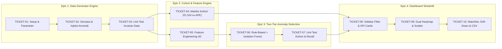

# TICKETS.md: Analisis Kohort Persistensi Polis & Deteksi Churn Agen (PAYDI)

Dokumen ini memecah spesifikasi di [SPEC.md](file:///c:/Users/USER/Downloads/Project%20Portfolio%20Data/Analisis%20Kohort%20Persistensi%20Polis%20&%20Deteksi%20Churn%20Agen/SPEC.md) menjadi **4 Epic** dan **10 Tiket Pengerjaan** yang terstruktur secara berurutan. Setiap tiket mencakup tujuan, pemetaan *User Stories*, rincian tugas teknis, spesifikasi input/output, serta *Acceptance Criteria*.

---

## EPIC 1: Synthetic Data Generator Engine (`generate_data.py`)

### 🎫 TICKET-01: Inisialisasi Proyek, Dependensi, & Konfigurasi Parameter Regulasi PAYDI
- **User Stories**: US-10 (*Parameterized synthetic data pipeline*)
- **File Target**: `requirements.txt`, `pytest.ini`, `generate_data.py` (konfigurasi & skema dasar)
- **Deskripsi & Cakupan Teknis**:
  1. Menyiapkan `requirements.txt` berisi pustaka inti: `streamlit`, `pandas`, `numpy`, `scikit-learn`, `plotly`, dan `pytest`.
  2. Menyiapkan struktur konfigurasi simulasi (`SimulationConfig`) yang dapat diparameterisasi:
     - Jumlah kohort bulanan: `24` bulan (*Issue Date* rentang 2 tahun, `M1`–`M24`).
     - Populasi agen: `150–200` agen (default `200`).
     - Populasi polis: `10.000–15.000` polis (default `12.000`).
     - Dimensi atribut organisasi: Kanal Distribusi (`Agency`, `Bancassurance`, `Worksite`) dan Kantor Cabang (`Jakarta`, `Surabaya`, `Bandung`, `Medan`, dll.).
     - Parameter benchmark persistensi M13 normal sesuai standar OJK/AAJI (`80%–85%`).
     - Parameter proporsi *ground-truth* anomali: `8%` total (`3%` *Hit-and-Run*, `5%` *Cherry-Picking*).
- **Acceptance Criteria**:
  - [ ] Struktur direktori (`data/`, `tests/`) dan `requirements.txt` siap digunakan.
  - [ ] Parameter simulasi dapat diubah melalui argumen fungsi tanpa *hardcode* di dalam logika transisi.

---

### 🎫 TICKET-02: Engine Simulasi Siklus Status Polis Bulanan & Injeksi Anomali Ground-Truth
- **User Stories**: US-06, US-07, US-08, US-10
- **File Target**: `generate_data.py`
- **Deskripsi & Cakupan Teknis**:
  1. **Master Agen (`agents_df`)**:
     - Menghasilkan `agent_id`, `agent_name`, `channel`, `branch_office`, `join_date`, serta label *ground-truth* (`Normal` 92%, `Hit-and-Run` 3%, `Cherry-Picking` 5%).
  2. **Master Polis (`policies_df`)**:
     - Menghasilkan `policy_id`, `agent_id`, `cohort_month` (24 bulan), `issue_date`, `ape` (distribusi *log-normal* realistis untuk produk Unit Link/PAYDI), dan `payment_method` (`Auto-Debit` vs `Manual/Cash`).
  3. **Simulasi Transisi Status Bulanan (`history_df` dari M1 hingga M24)**:
     - Memodelkan 4 status siklus hidup polis: `Active`, `Grace Period` (30–45 hari sebelum *lapse*), `Lapsed`, dan `Surrendered`.
     - Menjamin aturan transisi satu arah: polis yang sudah `Lapsed` atau `Surrendered` tetap berada di status terminal pada bulan-bulan berikutnya (tanpa *resurrection* ilegal).
  4. **Skenario Injeksi Perilaku Agen**:
     - **Agen Normal (92%)**: Atribusi `Auto-Debit` dominan (~80%), laju *attrition* alami bertahap sehingga persistensi M13 berada di rentang target **80%–85%**.
     - **Agen Hit-and-Run (3%)**: Konsentrasi pembayaran `Manual/Cash` tinggi (indikasi potensi talangan premi/nasabah fiktif), persistensi M1–M12 tampak sangat sehat (>90%), lalu mengalami *lapse shock* serempak (>35%–60% drop) di **M13–M14** pasca pencairan FYC & bonus M13. Sebagian polis menunjukkan sinyal `Grace Period` di M11–M12.
     - **Agen Cherry-Picking (5%)**: Memiliki variasi nilai polis (premi kecil vs premi *high-ticket*). Pada M13, agen mempertahankan polis-polis bernominal kecil agar **Persistensi Volume M13 tetap ~80%** (lolos ambang batas standar), tetapi membiarkan polis bernilai APE besar *lapse* sehingga **Persistensi APE M13 anjlok >50%**.
- **Acceptance Criteria**:
  - [ ] Output menghasilkan 3 tabel utama (`agents`, `policies`, `history`) yang dapat disimpan ke CSV/Parquet di `data/` atau dipanggil langsung di memori dengan `random_seed` deterministik.
  - [ ] Sinyal `Grace Period` terefleksi secara spesifik di sekitar M11 dan M12 sebelum polis jatuh ke status `Lapsed` di M13.

---

### 🎫 TICKET-03: Pengujian Invarian & Integritas Data Generator (`tests/test_generate_data.py`)
- **User Stories**: Testing Decisions (*Data Generator Invariant Tests*)
- **File Target**: `tests/test_generate_data.py`
- **Deskripsi & Cakupan Teknis**:
  1. **Test Skala & Dimensi Kohort**: Memastikan jumlah agen (150–200), jumlah polis (10.000–15.000), dan jumlah kohort (24 bulan) sesuai spesifikasi.
  2. **Test Integritas Referensial Polis**: Memastikan jumlah polis unik di log riwayat bulanan (`history_df`) tidak melebihi dan merupakan himpunan bagian dari master polis (`policies_df`).
  3. **Test Validitas Transisi Status**: Memastikan tidak ada polis dengan status `Lapsed` atau `Surrendered` pada bulan $M_t$ yang kembali menjadi `Active` atau `Grace Period` pada bulan $M_{t+1}$.
  4. **Test Benchmark OJK Populasi Normal**: Memastikan tingkat persistensi M13 populasi agen normal berada di dalam rentang **80%–85%**.
  5. **Test Proporsi Ground-Truth**: Memastikan proporsi injeksi agen *Hit-and-Run* (3%) dan *Cherry-Picking* (5%) akurat.
- **Acceptance Criteria**:
  - [ ] Seluruh pengujian di `pytest tests/test_generate_data.py` lulus (`PASSED` 100%).

---

## EPIC 2: Matriks Analisis Kohort 2D & Rekayasa Fitur Agen (`detector.py` - Bagian 1)

### 🎫 TICKET-04: Kalkulasi Matriks Kohort Dua Dimensi (Volume vs APE M1–M24) & Monitor Grace Period
- **User Stories**: US-01, US-02, US-06, US-08
- **File Target**: `detector.py`
- **Deskripsi & Cakupan Teknis**:
  1. **Fungsi Filter Granular**: Mendukung pemfilteran dataset berdasarkan `channel`, `branch_office`, dan `agent_id`.
  2. **Kalkulasi Matriks Persistensi Volume (`Volume Cohort Matrix`)**:
     - Baris: `cohort_month` (24 kohort bulanan), Kolom: bulan polis `M1` s/d `M24`.
     - Formula: $\text{Persistency}_{Vol}(M_t) = \frac{\text{Polis Aktif pada } M_t}{\text{Total Polis Awal Kohort } (M_1)} \times 100\%$.
  3. **Kalkulasi Matriks Persistensi Premi (`APE Cohort Matrix`)**:
     - Baris: `cohort_month`, Kolom: `M1` s/d `M24`.
     - Formula: $\text{Persistency}_{APE}(M_t) = \frac{\sum \text{APE Aktif pada } M_t}{\sum \text{Total APE Awal Kohort } (M_1)} \times 100\%$.
  4. **Kalkulasi Discrepancy / Leakage Matrix**: Selisih antara retensi Volume dan retensi APE ($\text{Persistency}_{Vol} - \text{Persistency}_{APE}$) per sel kohort untuk menyoroti kebocoran premi.
  5. **Early Warning Grace Period Extractor (M11–M12)**: Fungsi khusus untuk mengisolasi daftar polis dan agen yang sedang berada pada status `Grace Period` di bulan ke-11 dan ke-12 sebelum jatuh tempo M13.
- **Acceptance Criteria**:
  - [ ] Menghasilkan matriks DataFrame 24×24 untuk Volume dan APE yang akurat dan bebas dari *division-by-zero*.
  - [ ] Menyediakan ringkasan metrik agregat M13 (Volume vs APE) untuk dibandingkan langsung dengan ambang batas OJK/AAJI (80%–85%).

---

### 🎫 TICKET-05: Rekayasa Fitur Multivariat Level Agen (4 Dimensi Risiko)
- **User Stories**: US-05, US-07, US-11
- **File Target**: `detector.py`
- **Deskripsi & Cakupan Teknis**:
  1. Membangun fungsi `engineer_agent_features(agents_df, policies_df, history_df)` yang mengekstrak **4 fitur utama** sesuai [SPEC.md](file:///c:/Users/USER/Downloads/Project%20Portfolio%20Data/Analisis%20Kohort%20Persistensi%20Polis%20&%20Deteksi%20Churn%20Agen/SPEC.md):
     - **Fitur 1 — `lapse_shock_vol` ($\Delta \text{Persistency}_{Vol}$)**: Selisih tingkat persistensi jumlah polis antara bulan ke-12 dan bulan ke-13 ($\text{Persistency}_{Vol, M12} - \text{Persistency}_{Vol, M13}$).
     - **Fitur 2 — `lapse_shock_ape` ($\Delta \text{Persistency}_{APE}$)**: Selisih rasio retensi nilai premi antara bulan ke-12 dan bulan ke-13 ($\text{Persistency}_{APE, M12} - \text{Persistency}_{APE, M13}$).
     - **Fitur 3 — `ape_disparity_ratio`**: Rasio rata-rata nominal APE polis yang mengalami *lapse* (khususnya di sekitar M13) dibagi rata-rata nominal APE polis yang tetap *Active* ($\frac{\overline{\text{APE}}_{\text{Lapsed}}}{\overline{\text{APE}}_{\text{Active}}}$).
     - **Fitur 4 — `cash_payment_ratio` (*Payment Method Risk Concentration*)**: Persentase transaksi/polis agen yang menggunakan metode pembayaran `Manual/Cash` terhadap total polis agen.
  2. Menambahkan metrik pendukung (*context metrics*) untuk kebutuhan audit & *early warning*:
     - `m12_vol_persistency`, `m13_vol_persistency`, `m12_ape_persistency`, `m13_ape_persistency`
     - `grace_period_m11_m12_count` & `grace_period_m11_m12_ape` (volatilitas *Grace Period* M11–M12)
     - Penanganan *missing values* / *smoothing* aman untuk agen dengan volume penjualan rendah atau polis yang belum mencapai M13.
- **Acceptance Criteria**:
  - [ ] Keempat fitur bebas dari nilai `NaN` atau `inf` (aman untuk input model *scikit-learn*).
  - [ ] Fitur memiliki daya pisah (*separability*) yang jelas antara agen *Normal*, *Hit-and-Run*, dan *Cherry-Picking*.

---

## EPIC 3: Mesin Deteksi Anomali Two-Tier & Evaluasi Model (`detector.py` - Bagian 2)

### 🎫 TICKET-06: Arsitektur Deteksi Two-Tier (Rule-Based Screening + Isolation Forest)
- **User Stories**: US-03, US-04, US-05
- **File Target**: `detector.py`
- **Deskripsi & Cakupan Teknis**:
  1. **Tier 1 — Hard Rule-Based Screening (Kepatuhan Deterministik)**:
     - Menandai agen yang melanggar batas kepatuhan eksplisit:
       - $\Delta \text{Persistency}_{Vol} > 25\%$ (indikasi kuat *Hit-and-Run*), **ATAU**
       - Persistensi Volume M13 $< 75\%$ (di bawah batas toleransi minimum OJK/AAJI).
  2. **Tier 2 — Unsupervised Isolation Forest (Deteksi Multivariat Halus)**:
     - Melatih `IsolationForest` (dengan *standard scaling* pada 4 fitur: `lapse_shock_vol`, `lapse_shock_ape`, `ape_disparity_ratio`, `cash_payment_ratio`).
     - Mengonversi *decision function* menjadi **Anomaly Score kontinu (`0.0` hingga `1.0`)**, di mana skor mendekati `1.0` menunjukkan tingkat anomali tertinggi.
     - Mengidentifikasi agen *outlier* yang **lolos dari saringan Tier 1** namun tertangkap oleh pola multivariat Tier 2 (seperti perilaku *Cherry-Picking* di mana volume M13 aman ~80% tetapi APE anjlok dan `ape_disparity_ratio` tinggi).
  3. **Interpretabilitas & Risk Driver Attribution**:
     - Menghasilkan kolom klasifikasi risiko (`Normal`, `Tier 1: Rule Violation (Hit-and-Run)`, `Tier 2: ML Anomaly (Cherry-Picking / Hidden Leakage)`).
     - Menghasilkan teks penjelasan otomatis (`primary_risk_drivers`) per agen (contoh: *"APE Lapse Shock 54.2% vs Vol Drop 12.0%; High-value policies lapsed (Disparity 3.4x); Cash Ratio 68%"*) sebagai bukti kuantitatif sidang audit.
- **Acceptance Criteria**:
  - [ ] Setiap agen memiliki `anomaly_score` dalam rentang `[0, 1]`, status flag Tier 1, status flag Tier 2, kategori risiko gabungan, dan rincian *risk drivers*.

---

### 🎫 TICKET-07: Pengujian Seam Kalkulasi Kohort & Evaluasi Model Deteksi (`tests/test_detector.py`)
- **User Stories**: Testing Decisions (*Cohort Calculation Seam Tests* & *Detection Model Evaluation Tests*)
- **File Target**: `tests/test_detector.py`
- **Deskripsi & Cakupan Teknis**:
  1. **Cohort Calculation Seam Tests**:
     - Memvalidasi akurasi formula persistensi Volume dan APE terhadap perhitungan manual pada sampel kohort.
     - Memverifikasi sifat **monoton menurun atau konstan** ($\text{Persistency}(M_{t+1}) \le \text{Persistency}(M_t)$) di seluruh baris kohort M1–M24 baik untuk matriks Volume maupun APE.
  2. **Detection Model Evaluation Tests**:
     - Menguji **Recall** deteksi terhadap label *ground-truth* sintetis (`is_anomaly == True`), memastikan **Recall $\ge 85\%$ pada Top-20% *risk ranking*** (berdasarkan `anomaly_score` dan flag Tier 1/2).
     - Menguji kemampuan Tier 2 (*Isolation Forest*) dalam menangkap agen *Cherry-Picking* yang sengaja lolos dari aturan volume Tier 1.
     - Menguji ketahanan (*robustness*) pipeline terhadap input *missing values* (`NaN`) atau agen dengan jumlah polis sangat sedikit (misal 1–2 polis).
- **Acceptance Criteria**:
  - [ ] Seluruh pengujian di `pytest tests/test_detector.py` lulus (`PASSED` 100%) dengan *Recall* $\ge 85\%$.

---

## EPIC 4: Presentation & Interactive Dashboard Layer (`app.py`)

### 🎫 TICKET-08: Kerangka UI Streamlit, Sidebar Filter Multi-Dimensi, & Executive KPI Banner
- **User Stories**: US-01, US-02, US-06, US-08, US-09
- **File Target**: `app.py`
- **Deskripsi & Cakupan Teknis**:
  1. **Sidebar Kontrol & Filter**:
     - Filter multi-pilih untuk **Kanal Distribusi** (`Agency`, `Bancassurance`, `Worksite`) dan **Kantor Cabang**.
     - Parameter kustomisasi ambang batas deteksi (slider threshold $\Delta \text{Persistency}_{Vol}$ Tier 1 & kuantil kontaminasi *Isolation Forest* Tier 2).
     - Tombol regenerasi/muat ulang dataset sintetis dengan *seed* yang dapat diatur.
  2. **Executive Summary KPI Cards**:
     - **M13 Volume Persistency** (dengan indikator status terhadap standar OJK/AAJI 80%–85%).
     - **M13 APE Persistency & Premium Leakage Gap** (selisih % dan nominal Rp APE yang bocor di M13).
     - **Flagged High-Risk Agents** (jumlah agen terdeteksi di Tier 1 vs Tier 2).
     - **Early Warning M11–M12 Grace Period** (jumlah polis & total APE yang saat ini berada di *Grace Period* M11–M12 dan butuh intervensi retensi segera).
- **Acceptance Criteria**:
  - [ ] Perubahan filter pada sidebar memperbarui seluruh metrik KPI dan visualisasi secara *real-time*.

---

### 🎫 TICKET-09: Visualisasi Dual-Cohort Heatmap (Volume vs APE) & Scatter Plot Klaster Anomali
- **User Stories**: US-01, US-02, US-04, US-08, US-09
- **File Target**: `app.py`
- **Deskripsi & Cakupan Teknis**:
  1. **Dual-Cohort Heatmap Berdampingan (*Side-by-Side*)**:
     - Panel Kiri: **Volume Retention Matrix (M1–M24)** dengan gradien warna persistensi dan garis penanda batas kritis **M12–M13**.
     - Panel Kanan: **APE Retention Matrix (M1–M24)** pada skala warna yang sama agar *premium leakage* (perubahan warna drastis di M13 pada matriks APE dibanding Volume) langsung terlihat secara visual.
     - Opsi *toggle* untuk melihat **Discrepancy Heatmap (Volume % − APE %)**.
  2. **Scatter Plot Anomali Multivariat**:
     - Sumbu X: $\Delta \text{Persistency}_{Vol}$ (*Lapse Shock Volume* M12–M13).
     - Sumbu Y: $\Delta \text{Persistency}_{APE}$ (*Lapse Shock APE* M12–M13).
     - Ukuran titik (*bubble size*): `ape_disparity_ratio` atau total APE agen; Warna titik: Kategori Deteksi (`Normal`, `Tier 1: Hit-and-Run`, `Tier 2: Cherry-Picking`).
     - Garis bantu (*threshold lines*) yang membagi kuadran perilaku agen normal vs zona *Cherry-Picking* vs zona *Hit-and-Run*.
  3. **Panel Early Warning Retensi (M11–M12 Grace Period)**:
     - Grafik & tabel ringkas polis berisiko tinggi yang sedang dalam masa tenggang (*Grace Period*) di M11–M12 untuk ditindaklanjuti oleh *Retention Manager*.
- **Acceptance Criteria**:
  - [ ] Kedua heatmap tampil berdampingan dengan *tooltip* detail per kohort dan bulan polis.
  - [ ] Scatter plot memisahkan klaster *Normal*, *Hit-and-Run*, dan *Cherry-Picking* secara jelas dan interaktif.

---

### 🎫 TICKET-10: Agent Risk Watchlist Interaktif, Drill-Down Bukti Audit, & Ekspor CSV
- **User Stories**: US-03, US-05, US-07, US-12
- **File Target**: `app.py`
- **Deskripsi & Cakupan Teknis**:
  1. **Tabel Interaktif *Agent Risk Watchlist***:
     - Filter berdasarkan Status Tier (`All`, `Tier 1 Only`, `Tier 2 Only`), rentang `Anomaly Score`, dan status investigasi audit.
     - Menampilkan kolom kunci: `agent_id`, `agent_name`, `channel`, `branch_office`, `detection_tier`, `anomaly_score`, `m13_vol_persistency`, `m13_ape_persistency`, `lapse_shock_vol`, `lapse_shock_ape`, `ape_disparity_ratio`, `cash_payment_ratio`, dan `primary_risk_drivers`.
  2. **Fitur *Agent Evidence Drill-Down* (Pembuktian Audit per Agen)**:
     - Saat pengguna memilih satu agen dari *Watchlist*, dashboard menampilkan:
       - **Dual-Cohort Curve / Heatmap Spesifik Agen** (perbandingan kurva retensi Volume vs APE dari M1–M24 milik agen tersebut vs benchmark perusahaan).
       - **Profil Risiko 4 Dimensi & Distribusi Pembayaran** (proporsi `Manual/Cash` vs `Auto-Debit`, serta perbandingan ukuran APE polis yang *Active* vs *Lapsed*).
  3. **Tombol Ekspor Audit CSV**:
     - Tombol `Download Prioritized Watchlist (CSV)` yang mengekspor daftar agen berisiko sesuai filter aktif untuk diimpor langsung ke sistem manajemen audit internal.
- **Acceptance Criteria**:
  - [ ] Auditor dapat memilih agen mana pun di *Watchlist* untuk melihat pembuktian visual *dual-cohort* dan penjelasan fitur kuantitatifnya.
  - [ ] File CSV yang diunduh memiliki struktur kolom yang bersih dan lengkap untuk pelaporan audit.
