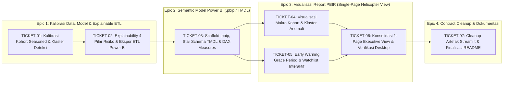

# TICKETS.md: Analisis Kohort Persistensi Polis & Deteksi Churn Agen (PAYDI) — Migrasi Power BI (.pbip)

Dokumen ini memecah spesifikasi di [SPEC.md](file:///c:/Users/USER/Downloads/Project%20Portfolio%20Data/Analisis%20Kohort%20Persistensi%20Polis%20%26%20Deteksi%20Churn%20Agen/SPEC.md) menjadi **4 Epic** dan **7 Tracer-Bullet Tickets** yang terstruktur dengan ketergantungan (*blocking edges*) yang jelas. Strategi migrasi menggunakan pola **Expand–Contract**: membangun dan memvalidasi pipeline ETL + proyek Power BI (`.pbip`) terlebih dahulu hingga terverifikasi penuh, lalu membersihkan artefak Streamlit lama di tiket penutup.

---

## Ringkasan Urutan & Ketergantungan Tiket (*Task Graph*)

| ID Tiket | Judul Tiket | Blocked By | Status |
| :--- | :--- | :--- | :--- |
| **TICKET-01** | Kalibrasi Kohort *Seasoned* (`2022-01` s/d `2023-12`) & Pemisahan Klaster Deteksi Two-Tier | None *(Dapat dimulai langsung)* | `completed` |
| **TICKET-02** | Dekomposisi Explainability 4 Pilar Risiko (`0–100`), Pipeline Ekspor CSV Power BI & Aset Logo PNG | **TICKET-01** | `completed` |
| **TICKET-03** | Scaffolding Proyek `.pbip`, Star Schema TMDL, Parameter `DataFolderPath`, & DAX Measures Berbobot | **TICKET-02** | `completed` |
| **TICKET-04** | Implementasi PBIR Visualisasi Kohort (Volume vs APE) & Peta Klaster Anomali 4D | **TICKET-03** | `completed` |
| **TICKET-05** | Implementasi PBIR Early Warning Grace Period & Watchlist Agen Terpadu | **TICKET-03** | `completed` |
| **TICKET-06** | Konsolidasi **Single-Page Executive Helicopter View (`1280×720`)** & Verifikasi Power BI Desktop | **TICKET-04**, **TICKET-05** | `completed` |
| **TICKET-07** | Pembersihan Artefak Streamlit/Docker/Mockup Lama (*Contract Phase*) & Pembaruan Dokumentasi Portofolio | **TICKET-06** | `completed` |

---

## EPIC 1: Kalibrasi Data Sintetis Aktuaria, Model Deteksi, & Explainable ETL

### 🎫 TICKET-01: Kalibrasi Kohort *Seasoned* (`2022-01` s/d `2023-12`) & Pemisahan Klaster Deteksi Two-Tier

- **Blocked by**: None *(can start immediately)*
- **Status**: `ready-for-agent`
- **User Stories**: US-01, US-04, US-05, US-11

#### What to Build (End-to-End Behavior)
Memperbaiki logika simulasi data sintetis dan mesin deteksi dua tingkat (*Two-Tier Anomaly Detection*) agar:
1. Periode terbit kohort merepresentasikan studi observasi 24 bulan penuh yang telah matang (*Fully Seasoned Cohort Study* dari `2022-01` hingga `2023-12`), sehingga matriks retensi 24×24 (`M1–M24`) dan evaluasi `M13` valid 100% secara kalender aktuaria.
2. Tidak ada lagi agen `Normal` dengan *lapse shock* M12→M13 rendah (`0%–3%`) yang salah diklasifikasikan sebagai `Hit and Run` akibat penurunan alami bertahap.
3. Agen `Cherry-Picking` mempertahankan persistensi Volume M13 di sekitar ~80% (lolos saringan volume Tier 1 sesuai definisi bisnis) namun mengalami kejatuhan APE M13 yang tajam dan rasio disparitas premi tinggi, sehingga tertangkap secara akurat sebagai `Cherry Picking` oleh Tier 2 (*Isolation Forest*), bukan tertelan menjadi `Hit and Run`.

#### Kriteria Teknis & Dokumentasi Detail
1. **Kalibrasi Generator Data Sintetis**:
   - Ubah parameter default awal kohort pada konfigurasi simulasi menjadi `2022-01` dengan `24` kohort bulanan (`2022-01` s/d `2023-12`).
   - Kalibrasi profil polis agen `Cherry-Picking`: gunakan komposisi bimodal (~85% polis penyangga bernominal kecil Rp 4–9 Juta dengan retensi M13 tinggi ~88%–90%, dan ~15% polis *jumbo* Rp 60–150 Juta dengan tingkat *lapse* di M13 sebesar ~85%–90%). Pastikan total Persistensi Volume M13 agen `Cherry-Picking` berada di atas ambang batas minimum Tier 1 (`>= 75%`, rata-rata ~80%), sedangkan Persistensi APE M13 anjlok drastis (`lapse_shock_ape >= 30%`) dan `ape_disparity_ratio >= 2.5`.
   - Kalibrasi variansi agen `Normal` agar persistensi M13 populasi normal tetap berada di rentang benchmark OJK/AAJI (**80%–85%**) tanpa menghasilkan *outlier* penurunan palsu di M13.
2. **Perbaikan Aturan Deteksi Tier 1 & Klasifikasi Tier 2**:
   - **Tier 1 (`Hit and Run`)**: Tandai `tier1_violation = True` hanya jika terjadi guncangan volume akut di M13, yaitu `lapse_shock_vol > 25.0%` **ATAU** (`m13_vol_persistency < 75.0%` **DAN** `lapse_shock_vol >= 15.0%`).
   - **Tier 2 (`Cherry Picking`)**: Pertahankan `IsolationForest(n_estimators=150, contamination=0.08, random_state=42)` pada 4 fitur terstandarisasi (`lapse_shock_vol`, `lapse_shock_ape`, `ape_disparity_ratio`, `cash_payment_ratio`), dan pastikan agen yang lolos Tier 1 namun terdeteksi anomali pada Tier 2 diklasifikasikan sebagai `Cherry Picking`.
   - Perbarui fungsi penjelas faktor risiko (`_format_risk_drivers`) agar membedakan dengan jelas antara agen normal kepatuhan penuh, agen dengan *attrition* bertahap, *Hit and Run*, dan *Cherry Picking*.

#### Acceptance Criteria
- [ ] Rentang `cohort_month` yang dihasilkan adalah 24 bulan dari `2022-01` sampai `2023-12` dengan matriks retensi Volume dan APE berukuran `24×24` yang monoton tidak meningkat ($M_{t+1} \le M_t$).
- [ ] Tingkat persistensi Volume M13 untuk populasi agen `Normal` berada di dalam rentang benchmark OJK/AAJI (`80%–85%`).
- [ ] Pada evaluasi terhadap *ground-truth*:
  - Minimal **83%** agen `Hit-and-Run` tertangkap oleh Tier 1 (`Hit and Run`).
  - Minimal **80%** agen `Cherry-Picking` diklasifikasikan sebagai `Cherry Picking` (lolos dari Tier 1 namun tertangkap oleh Tier 2).
  - **0 agen `Normal`** dengan `lapse_shock_vol < 10%` yang salah dilabeli sebagai `Hit and Run`.
  - **Recall pada Top-20% Risk Ranking $\ge 85\%$** dan **Precision keseluruhan $\ge 80\%$**.
- [ ] Seluruh unit test invarian data dan evaluasi detektor lulus (`pytest` hijau).

---

### 🎫 TICKET-02: Dekomposisi Explainability 4 Pilar Risiko (`0–100`), Pipeline Ekspor CSV Power BI & Aset Logo PNG

- **Blocked by**: **TICKET-01**
- **Status**: `ready-for-agent`
- **User Stories**: US-06, US-12, US-13

#### What to Build (End-to-End Behavior)
Membangun dekomposisi *visual explainability* untuk membuka *black-box* skor *Isolation Forest* ke dalam **4 Skor Pilar Risiko (`0–100`)** beserta persentase kontribusinya, serta menyediakan satu skrip pipeline ETL deterministik yang mengekspor seluruh tabel CSV siap pakai untuk Power BI dan mengonversi logo resmi MNC Life ke format PNG resolusi tinggi.

#### Kriteria Teknis & Dokumentasi Detail
1. **Dekomposisi 4 Pilar Risiko Ternormalisasi (`0–100`) & Kontribusi Fitur**:
   - Tambahkan perhitungan 4 skor pilar pada level agen (skala `0.0` hingga `100.0`, dibulatkan 1 desimal):
     1. `score_vol_shock`: $\min(100, \frac{\text{lapse\_shock\_vol}}{45.0} \times 100)$ — mengukur keparahan guncangan volume M12→M13.
     2. `score_ape_shock`: $\min(100, \frac{\text{lapse\_shock\_ape}}{60.0} \times 100)$ — mengukur keparahan kebocoran premi APE M12→M13.
     3. `score_ape_disparity`: $\min(100, \frac{\max(0, \text{ape\_disparity\_ratio} - 1.0)}{4.0} \times 100)$ — mengukur ketimpangan nominal polis yang *lapse* vs *active*.
     4. `score_cash_ratio`: $\min(100, \frac{\text{cash\_payment\_ratio}}{80.0} \times 100)$ — mengukur konsentrasi pembayaran tunai/manual.
   - Hitung kontribusi proporsional tiap pilar (`share_vol_shock_pct`, `share_ape_shock_pct`, `share_ape_disparity_pct`, `share_cash_ratio_pct`) sehingga total keempatnya berjumlah `100.0%` untuk setiap agen, serta kolom `dominant_risk_pillar` (nama pilar dengan skor tertinggi).
   - Tambahkan kolom peringkat `risk_rank` (`1` s/d `200` berdasarkan `anomaly_score` menurun) dan flag boolean `is_top20_risk_rank` (`risk_rank <= 40`).
2. **Tabel Ekspor Power BI (Disimpan di `data/`)**:
   - `agents.csv` (200 baris), `policies.csv` (12.000 baris), `policy_monthly_status.csv` (288.000 baris).
   - `agent_risk_scores.csv` (200 baris): memuat seluruh atribut profil agen, `true_label`, `is_anomaly`, metrik retensi M12 & M13, 4 fitur risiko, `tier1_violation`, `tier2_anomaly`, `anomaly_score`, `risk_rank`, `is_top20_risk_rank`, `risk_category`, `primary_risk_drivers`, `dominant_risk_pillar`, 4 skor pilar (`0–100`), dan 4 persentase kontribusi pilar.
   - `agent_risk_pillars.csv` (800 baris = 200 agen × 4 pilar, format *unpivoted/long*):
     - Kolom: `agent_id`, `pillar_order` (`1–4`), `pillar_name` (`Volume Shock M12-M13`, `APE Leakage Shock M12-M13`, `APE Ticket Disparity`, `Manual/Cash Concentration`), `agent_raw_value`, `normal_benchmark_value`, `unit_label` (`%` atau `x`), `pillar_score_100`, `contribution_pct`.
3. **Konversi Aset Identitas Visual**:
   - Konversi logo resmi MNC Life dari SVG ke PNG beresolusi tinggi (`powerbi/assets/mnc_life_logo.png`) dengan latar transparan agar kompatibel penuh dengan visual *Image* native di Power BI Desktop.

#### Acceptance Criteria
- [ ] Menjalankan skrip ekspor ETL menghasilkan kelima file CSV di `data/` dan file `powerbi/assets/mnc_life_logo.png` tanpa error.
- [ ] `agent_risk_scores.csv` memiliki tepat 200 baris tanpa nilai `NaN`/`inf`, dengan seluruh skor pilar berada di rentang `[0, 100]` dan total persentase kontribusi = `100%`.
- [ ] `agent_risk_pillars.csv` memiliki tepat 800 baris (4 baris per `agent_id`) dengan nilai `normal_benchmark_value` yang akurat mewakili rata-rata populasi agen normal.
- [ ] Unit test khusus untuk dekomposisi 4 pilar dan skema ekspor ETL ditambahkan dan lulus (`pytest` hijau).

---

## EPIC 2: Fondasi Proyek Power BI (`.pbip`), Star Schema TMDL, & Ukuran DAX Berbobot

### 🎫 TICKET-03: Scaffolding Proyek `.pbip`, Star Schema TMDL, Parameter `DataFolderPath`, & DAX Measures Berbobot

- **Blocked by**: **TICKET-02**
- **Status**: `ready-for-agent`
- **User Stories**: US-02, US-03, US-07, US-12

#### What to Build (End-to-End Behavior)
Membangun proyek **Power BI Project (`powerbi/MNC_Life_PAYDI.pbip`)** beserta definisi **Semantic Model (`MNC_Life_PAYDI.SemanticModel/definition/*.tmdl`)** dan **Theme JSON MNC Life** yang memuat *Star Schema* 4 tabel, parameter portabel `DataFolderPath`, pengurutan bulan polis `M1–M24` yang benar, serta seluruh **DAX Measures** berstandar aktuaria/BI berbobot.

#### Kriteria Teknis & Dokumentasi Detail
1. **Struktur File Proyek `.pbip`**:
   - Entry point `powerbi/MNC_Life_PAYDI.pbip` yang menunjuk ke `MNC_Life_PAYDI.Report`.
   - `powerbi/MNC_Life_PAYDI.SemanticModel/definition.pbism` (versi skema standar Power BI).
   - `powerbi/MNC_Life_PAYDI.Report/definition.pbir` dengan referensi `byPath` ke `../MNC_Life_PAYDI.SemanticModel`.
2. **Desain Star Schema & Partisi Power Query (TMDL)**:
   - Buat *Named Expression / Parameter* `DataFolderPath` yang menunjuk ke direktori `data/` proyek agar path sumber data terpusat di satu parameter.
   - **Tabel 1 — `DimAgent`** (sumber: `agent_risk_scores.csv`):
     - Kunci utama: `agent_id`.
     - Menyimpan atribut organisasi (`agent_name`, `channel`, `branch_office`, `join_date`), metrik 4D fisik (untuk sumbu X/Y/Size Scatter Chart), `risk_category` (untuk Slicer & Legend Scatter Chart), `anomaly_score`, `risk_rank`, `is_top20_risk_rank`, `primary_risk_drivers`, `dominant_risk_pillar`, serta `true_label` & `is_anomaly` (di-organisir rapi untuk halaman validasi model).
   - **Tabel 2 — `DimPolicy`** (sumber: `policies.csv`):
     - Kunci utama: `policy_id`, kunci tamu: `agent_id`.
     - Menyimpan `cohort_month`, `issue_date` (Date), `ape` (Decimal/Currency), `payment_method`.
   - **Tabel 3 — `FactPolicyMonthlyStatus`** (sumber: `policy_monthly_status.csv`):
     - Kunci tamu: `policy_id`.
     - Menyimpan `month_index` (Int64 `1–24`), `status` (`Active`, `Grace Period`, `Lapsed`, `Surrendered`), dan kolom `Month Label` (`"M" & Text.From([month_index])`) dengan properti TMDL **`sortByColumn: month_index`**.
   - **Tabel 4 — `FactAgentRiskPillars`** (sumber: `agent_risk_pillars.csv`):
     - Kunci tamu: `agent_id`.
     - Menyimpan `pillar_order` (Int64 `1–4`), `pillar_name` (dengan **`sortByColumn: pillar_order`**), `agent_raw_value`, `normal_benchmark_value`, `unit_label`, `pillar_score_100`, `contribution_pct`.
   - **Relasi (`relationships.tmdl`)**:
     - `DimPolicy[agent_id]` (*) → (1) `DimAgent[agent_id]` (*Single direction*)
     - `FactPolicyMonthlyStatus[policy_id]` (*) → (1) `DimPolicy[policy_id]` (*Single direction*)
     - `FactAgentRiskPillars[agent_id]` (*) → (1) `DimAgent[agent_id]` (*Single direction*)
3. **Katalog DAX Measures Berbobot (*Weighted Portfolio Standard*)**:
   - **Kelompok 1 — Basis & Retensi Kohort Dinamis (M1–M24)**:
     - `Initial Policies` = `COUNTROWS(DimPolicy)`
     - `Initial APE` = `SUM(DimPolicy[ape])`
     - `Active Policies` = menghitung polis unik di `FactPolicyMonthlyStatus` dengan `status IN {"Active", "Grace Period"}`.
     - `Active APE` = menggunakan `TREATAS` dari daftar `policy_id` aktif di `FactPolicyMonthlyStatus` ke `DimPolicy[policy_id]` untuk menjumlahkan `DimPolicy[ape]` secara akurat pada setiap bulan polis.
     - `Persistency Volume %` = `DIVIDE([Active Policies], [Initial Policies])` (format `0.0%`)
     - `Persistency APE %` = `DIVIDE([Active APE], [Initial APE])` (format `0.0%`)
     - `Leakage Gap %` = `[Persistency Volume %] - [Persistency APE %]` (format `+0.0%;-0.0%;0.0%`)
   - **Kelompok 2 — KPI Eksekutif M13 & Benchmark Regulasi**:
     - `M13 Active Policies` & `M13 Active APE` (difilter pada `FactPolicyMonthlyStatus[month_index] = 13`).
     - `M13 Volume Persistency %` = `DIVIDE([M13 Active Policies], [Initial Policies])`
     - `M13 Volume vs AAJI Benchmark` = `[M13 Volume Persistency %] - 0.80`
     - `M13 APE Persistency %` = `DIVIDE([M13 Active APE], [Initial APE])`
     - `M13 Leakage Gap %` = `[M13 Volume Persistency %] - [M13 APE Persistency %]`
     - `M13 Leaked APE (IDR)` = `[Initial APE] - [M13 Active APE]`
     - `Total Agents` = `COUNTROWS(DimAgent)`
     - `Flagged Agents Count` = `CALCULATE(COUNTROWS(DimAgent), DimAgent[risk_category] <> "Normal")`
     - `Hit and Run Agents Count` = `CALCULATE(COUNTROWS(DimAgent), DimAgent[risk_category] = "Hit and Run")`
     - `Cherry Picking Agents Count` = `CALCULATE(COUNTROWS(DimAgent), DimAgent[risk_category] = "Cherry Picking")`
     - `Flagged Agents Subtitle` = teks dinamis `"Hit & Run: " & [Hit and Run Agents Count] & " | Cherry Picking: " & [Cherry Picking Agents Count]`
   - **Kelompok 3 — Early Warning Grace Period (M11–M12 Distinct per Polis)**:
     - `Grace Period Policies (M11-M12)` = `CALCULATE(DISTINCTCOUNT(FactPolicyMonthlyStatus[policy_id]), FactPolicyMonthlyStatus[month_index] IN {11, 12}, FactPolicyMonthlyStatus[status] = "Grace Period")`
     - `Grace Period APE (M11-M12)` = menggunakan `TREATAS` dari polis unik `Grace Period` di M11–M12 ke `DimPolicy[policy_id]` untuk menjumlahkan `DimPolicy[ape]` tanpa *double-counting*.
     - `Grace Period APE (Miliar IDR)` = `DIVIDE([Grace Period APE (M11-M12)], 1000000000)`
     - `Grace Period Cash Ratio %` & `Grace Period Auto-Debit Ratio %`.
   - **Kelompok 4 — Explainability 4 Pilar & Evaluasi Model (Ground-Truth Validation)**:
     - `Agent Pillar Score (0-100)` = `AVERAGE(FactAgentRiskPillars[pillar_score_100])`
     - `Agent Pillar Contribution %` = `DIVIDE(AVERAGE(FactAgentRiskPillars[contribution_pct]), 100)`
     - `Agent Raw Feature Value` = `AVERAGE(FactAgentRiskPillars[agent_raw_value])`
     - `Normal Benchmark Feature Value` = `AVERAGE(FactAgentRiskPillars[normal_benchmark_value])`
     - `Ground Truth Anomalies` = `CALCULATE(COUNTROWS(DimAgent), DimAgent[is_anomaly] = TRUE())`
     - `True Positives (Top 20% Rank)` = `CALCULATE(COUNTROWS(DimAgent), DimAgent[is_anomaly] = TRUE(), DimAgent[is_top20_risk_rank] = TRUE())`
     - `Top-20% Recall %` = `DIVIDE([True Positives (Top 20% Rank)], [Ground Truth Anomalies])`
     - `True Positives (Flagged)` = `CALCULATE(COUNTROWS(DimAgent), DimAgent[is_anomaly] = TRUE(), DimAgent[risk_category] <> "Normal")`
     - `Overall Recall %` = `DIVIDE([True Positives (Flagged)], [Ground Truth Anomalies])`
     - `Detection Precision %` = `DIVIDE([True Positives (Flagged)], [Flagged Agents Count])`
4. **Identitas Visual & Theme JSON MNC Life (`MNC_Life_Theme.json`)**:
   - Konfigurasi warna data, latar kanvas `#FFFFFF`, permukaan kartu `#F5F8FC`, border `#D9E5F2`, warna primer `#192C4D`, aksen emas `#C89B2C`, merah peringatan `#D94B4B`, hijau kepatuhan `#1E6B52`, dan tipografi kontras tinggi mengacu pada [DESIGN.md](file:///c:/Users/USER/Downloads/Project%20Portfolio%20Data/Analisis%20Kohort%20Persistensi%20Polis%20%26%20Deteksi%20Churn%20Agen/DESIGN.md).

#### Acceptance Criteria
- [ ] Struktur folder `powerbi/MNC_Life_PAYDI.pbip`, `MNC_Life_PAYDI.SemanticModel`, dan `MNC_Life_PAYDI.Report` terbentuk lengkap dan sesuai spesifikasi skema PBIP/TMDL.
- [ ] Seluruh tabel, kolom, tipe data, properti `sortByColumn`, relasi *Star Schema*, dan formula DAX terdefinisi secara valid tanpa syntax error.
- [ ] Theme JSON MNC Life terdaftar di definisi laporan (`report.json`) dan siap digunakan oleh seluruh halaman visual.

---

## EPIC 3: Implementasi Single-Page Executive Helicopter View PBIR (`MNC_Life_PAYDI.Report`)

> **Catatan Arsitektur Final (Konsolidasi Solusi C):** Setelah tinjauan eksekutif terhadap versi awal 5 halaman, disepakati penyederhanaan menjadi **1 Halaman Utama (`Executive Helicopter View`, kanvas `1280 × 720`, 13 Visual)** agar pesan bisnis tersampaikan dalam satu layar tanpa navigasi tab, sementara seluruh ukuran model semantik (DAX & 4 pilar risiko) tetap tersedia penuh untuk tooltip dan analisis lanjutan.

### 🎫 TICKET-04 s/d TICKET-06: Implementasi Konsolidasi 1-Halaman PBIR & Verifikasi Desktop (`completed`)

- **Blocked by**: **TICKET-03**
- **Status**: `completed`
- **User Stories**: US-01 s/d US-12

#### What to Build (End-to-End Behavior)
Membangun definisi PBIR lengkap (`page.json` & `visual.json`) untuk **Halaman 1 (Matriks Kohort Volume vs APE & Leakage Gap)** dan **Halaman 2 (Peta Sebaran Anomali Agen 4D)** lengkap dengan header korporat MNC Life, Slicer Global (`channel` & `branch_office`), dan 4 Kartu KPI Eksekutif.

#### Kriteria Teknis & Dokumentasi Detail
1. **Header Global, Slicer Panel, & 4 KPI Cards**:
   - Judul dashboard, lencana regulasi (`SEOJK No. 5/SEOJK.05/2022 | Standar AAJI M13: 80%-85% | Fully Seasoned Cohort 2022–2023`), dan logo MNC Life.
   - Slicer `DimAgent[channel]` dan `DimAgent[branch_office]`.
   - 4 Kartu KPI utama:
     1. `M13 Volume Persistency %` (beserta selisih terhadap target AAJI 80%).
     2. `M13 APE Persistency %` (beserta `M13 Leakage Gap %`).
     3. `Flagged Agents Count` (beserta rincian `Hit and Run` vs `Cherry Picking`).
     4. `Grace Period Policies (M11-M12)` (beserta `Grace Period APE (Miliar IDR)`).
2. **Halaman 1 — `Matriks Kohort (Volume vs APE)`**:
   - **Matrix 1 — Retensi Volume Polis (%)**: Baris `DimPolicy[cohort_month]`, Kolom `FactPolicyMonthlyStatus[Month Label]` (`M1–M24`), Nilai `[Persistency Volume %]`.
   - **Matrix 2 — Retensi Premi APE (%)**: Baris `DimPolicy[cohort_month]`, Kolom `FactPolicyMonthlyStatus[Month Label]` (`M1–M24`), Nilai `[Persistency APE %]`.
   - **Matrix 3 — Selisih Kebocoran Premi (`Leakage Gap %`)**: Baris `DimPolicy[cohort_month]`, Kolom `FactPolicyMonthlyStatus[Month Label]` (`M1–M24`), Nilai `[Leakage Gap %]` untuk menyoroti lonjakan kebocoran di `M13–M24`.
3. **Halaman 2 — `Peta Sebaran Anomali Agen`**:
   - **Scatter/Bubble Chart 4D**:
     - Details/Values: `DimAgent[agent_id]`
     - X-Axis: `DimAgent[lapse_shock_vol]` ($\Delta$ Persistensi Volume M12→M13 %)
     - Y-Axis: `DimAgent[lapse_shock_ape]` ($\Delta$ Persistensi APE M12→M13 %)
     - Size: `DimAgent[ape_disparity_ratio]` (Disparitas Premi)
     - Legend: `DimAgent[risk_category]` (`Normal`, `Hit and Run`, `Cherry Picking`)
     - Tooltips: `agent_name`, `channel`, `branch_office`, `anomaly_score`, `cash_payment_ratio`, `primary_risk_drivers`.
   - Kartu/visual penjelas karakteristik 3 zona perilaku (*Normal*, *Hit and Run*, *Cherry Picking*) beserta perbandingan rata-rata metriknya.

#### Acceptance Criteria
- [ ] Halaman 1 dan Halaman 2 terdefinisi lengkap di dalam `MNC_Life_PAYDI.Report/definition/pages/` dengan ukuran kanvas, tata letak non-overlapping, dan binding kolom/measure yang valid terhadap `MNC_Life_PAYDI.SemanticModel`.
- [ ] Kolom bulan pada ketiga Matrix di Halaman 1 terurut rapi dari `M1` hingga `M24`.
- [ ] Scatter Chart di Halaman 2 memetakan keempat dimensi risiko (`lapse_shock_vol`, `lapse_shock_ape`, `ape_disparity_ratio`, `risk_category`) secara akurat.

---

### 🎫 TICKET-05: Implementasi PBIR Halaman 3 (Early Warning Grace Period) & Halaman 4 (Watchlist, Kurva M1–M24 & 4 Pilar Risiko)

- **Blocked by**: **TICKET-03**
- **Status**: `ready-for-agent`
- **User Stories**: US-06, US-08, US-09, US-10

#### What to Build (End-to-End Behavior)
Membangun definisi PBIR lengkap untuk **Halaman 3 (Early Warning Grace Period M11–M12)** guna intervensi retensi proaktif, serta **Halaman 4 (Watchlist & Pemeriksaan Detail Agen)** yang mengintegrasikan tabel pengawasan agen dengan kurva siklus hidup M1–M24 dan **Bar Chart Explainability 4 Pilar Risiko (0–100)**.

#### Kriteria Teknis & Dokumentasi Detail
1. **Halaman 3 — `Early Warning Grace Period (M11-M12)`**:
   - Kartu metrik ringkasan: `Grace Period Policies (M11-M12)`, `Grace Period APE (Miliar IDR)`, `Grace Period Cash Ratio %`, dan `Grace Period Auto-Debit Ratio %`.
   - **Donut / Bar Chart Metode Pembayaran** (`DimPolicy[payment_method]` terhadap `[Grace Period Policies (M11-M12)]` dan `[Grace Period APE (M11-M12)]`).
   - **Bar Chart Cabang / Kanal Rawan Lapse**: Distribusi nominal APE *Grace Period* M11–M12 per `branch_office` dan `channel`.
   - **Tabel Prioritas Intervensi Polis (M11–M12)**: Menampilkan daftar polis yang berstatus `Grace Period` pada `month_index IN {11, 12}` beserta `policy_id`, `agent_id`, `agent_name`, `branch_office`, `cohort_month`, `month_index`, `ape`, dan `payment_method`.
2. **Halaman 4 — `Watchlist & Detail Bukti Agen`**:
   - Filter Slicer: `DimAgent[risk_category]`, `DimAgent[dominant_risk_pillar]`, dan Slicer pilihan `DimAgent[agent_id]` / `agent_name`.
   - **Tabel Interaktif *Agent Risk Watchlist***: Menampilkan `risk_rank`, `agent_id`, `agent_name`, `channel`, `branch_office`, `risk_category`, `anomaly_score`, `m13_vol_persistency`, `m13_ape_persistency`, `lapse_shock_vol`, `lapse_shock_ape`, `ape_disparity_ratio`, `cash_payment_ratio`, `dominant_risk_pillar`, dan `primary_risk_drivers`.
   - **Panel Master-Detail Kiri — Kurva Siklus Hidup M1–M24 (`Line Chart`)**:
     - X-Axis: `FactPolicyMonthlyStatus[Month Label]` (`M1–M24`)
     - Y-Axis: `[Persistency Volume %]` dan `[Persistency APE %]`
     - Menampilkan divergennya kurva Volume vs APE tepat di titik `M13` ketika satu agen berisiko dipilih pada tabel Watchlist.
   - **Panel Master-Detail Kanan — Dekomposisi Explainability 4 Pilar Risiko (`Bar Chart`)**:
     - Sumbu Kategori: `FactAgentRiskPillars[pillar_name]` (`Volume Shock M12-M13`, `APE Leakage Shock M12-M13`, `APE Ticket Disparity`, `Manual/Cash Concentration`).
     - Nilai: `[Agent Pillar Score (0-100)]` dan `[Agent Pillar Contribution %]` (beserta tooltip perbandingan `[Agent Raw Feature Value]` vs `[Normal Benchmark Feature Value]`).
     - Menjawab secara visual dan instan *mengapa* agen terpilih mendapatkan skor anomali tinggi.

#### Acceptance Criteria
- [ ] Halaman 3 menampilkan khusus polis yang berada pada status `Grace Period` di bulan ke-11 dan ke-12 tanpa *double-counting* pada KPI total polis maupun total APE.
- [ ] Halaman 4 memungkinkan interaksi *cross-filtering*: saat satu baris agen pada *Watchlist* diklik, *Line Chart* M1–M24 dan *Bar Chart* 4 Pilar Risiko otomatis memperbarui kurva serta profil dekomposisi risiko agen tersebut.
- [ ] Seluruh visual di Halaman 3 dan Halaman 4 memiliki binding field yang valid terhadap model TMDL.

---

### 🎫 TICKET-06: Implementasi PBIR Halaman 5 (Validasi & Evaluasi Model) & Verifikasi End-to-End di Power BI Desktop

- **Blocked by**: **TICKET-04**, **TICKET-05**
- **Status**: `ready-for-agent`
- **User Stories**: US-04, US-05, US-11, US-12

#### What to Build (End-to-End Behavior)
Membangun **Halaman 5 (Evaluasi & Validasi Model terhadap Ground-Truth)** untuk membuktikan akurasi metodologi deteksi secara transparan, lalu membuka dan memverifikasi keseluruhan proyek `MNC_Life_PAYDI.pbip` di Power BI Desktop lokal serta menguji akurasi setiap ukuran DAX melalui `powerbi-modeling-mcp`.

#### Kriteria Teknis & Dokumentasi Detail
1. **Halaman 5 — `Evaluasi & Validasi Model`**:
   - **4 Kartu KPI Validasi Metodologi**:
     1. `Top-20% Recall %` (membuktikan pencapaian target $\ge 85\%$ sesuai [SPEC.md](file:///c:/Users/USER/Downloads/Project%20Portfolio%20Data/Analisis%20Kohort%20Persistensi%20Polis%20%26%20Deteksi%20Churn%20Agen/SPEC.md)).
     2. `Overall Recall %` (proporsi total agen anomali *ground-truth* yang berhasil ditangkap).
     3. `Detection Precision %` (kemurnian tangkapan agen berisiko tanpa *false positive* berlebih).
     4. `Ground Truth Anomalies` vs `Flagged Agents Count`.
   - **Visual Confusion Matrix (`Matrix Visual`)**:
     - Baris: `DimAgent[true_label]` (`Normal`, `Hit-and-Run`, `Cherry-Picking`)
     - Kolom: `DimAgent[risk_category]` (`Normal`, `Hit and Run`, `Cherry Picking`)
     - Nilai: `[Total Agents]`
   - **Visual Perbandingan Profil Fitur & Skor per Ground-Truth (`Clustered Column / Bar Chart`)**:
     - Membandingkan rata-rata 4 Skor Pilar Risiko (`score_vol_shock`, `score_ape_shock`, `score_ape_disparity`, `score_cash_ratio`) dan `anomaly_score` antar kelompok `true_label`.
   - **Tabel Audit Perbandingan Prediksi vs Ground-Truth**: Menampilkan daftar agen anomali beserta `true_label`, `risk_category`, `risk_rank`, `is_top20_risk_rank`, `anomaly_score`, dan `dominant_risk_pillar`.
2. **Verifikasi End-to-End di Power BI Desktop & Modeling MCP**:
   - Buka `powerbi/MNC_Life_PAYDI.pbip` menggunakan Power BI Desktop lokal (`PBIDesktop.exe`).
   - Hubungkan `powerbi-modeling-mcp` ke instance lokal / proyek untuk memverifikasi bahwa seluruh tabel, relasi, dan ukuran DAX dievaluasi tanpa error.
   - Jalankan kueri DAX verifikasi untuk memastikan angka KPI M13, matriks kohort, *Grace Period*, dan *Confusion Matrix* di Power BI cocok 100% dengan perhitungan Python.

#### Acceptance Criteria
- [ ] Halaman 5 terdefinisi lengkap di `MNC_Life_PAYDI.Report` dan menampilkan Confusion Matrix serta metrik `Top-20% Recall %` $\ge 85\%$.
- [ ] Proyek `powerbi/MNC_Life_PAYDI.pbip` berhasil dibuka di Power BI Desktop lokal tanpa pesan error skema TMDL maupun PBIR.
- [ ] Evaluasi kueri DAX membuktikan kecocokan angka antara model semantik Power BI dan hasil pipeline Python.

---

## EPIC 4: Finalisasi Migrasi, Cleanup Artefak Streamlit Lama, & Dokumentasi Portofolio

### 🎫 TICKET-07: Pembersihan Artefak Streamlit/Docker/Mockup Lama (*Contract Phase*) & Pembaruan Dokumentasi Portofolio

- **Blocked by**: **TICKET-06**
- **Status**: `ready-for-agent`
- **User Stories**: US-12, US-13

#### What to Build (End-to-End Behavior)
Menyelesaikan fase *Contract* dari migrasi penuh ke Power BI dengan menghapus seluruh kode antarmuka Streamlit, konfigurasi Docker, dan file mockup lama, merampingkan dependensi Python, serta memperbarui `README.md` menjadi dokumentasi portofolio Power BI + Python ML ETL yang bersih dan komprehensif.

#### Kriteria Teknis & Dokumentasi Detail
1. **Pembersihan Berkas Legacy UI**:
   - Hapus berkas antarmuka Streamlit dan mockup yang sudah digantikan oleh proyek `.pbip`:
     - `app.py`
     - `visuals.py`
     - `.streamlit/` (`config.toml`)
     - `Dockerfile` dan `.dockerignore`
     - `mockup_app.py`, `generate_pygwalker_mockup.py`, dan `pygwalker_mockup.html`
     - `tests/test_app_components.py`
2. **Pembaruan Dependensi & Konfigurasi Git**:
   - Perbarui `requirements.txt` agar hanya memuat pustaka yang benar-benar digunakan oleh engine data, model ML, dan pengujian (`pandas`, `numpy`, `scikit-learn`, `pytest`).
   - Pastikan `.gitignore` mengecualikan file cache sementara Power BI (`*.abf`, `cache.abf`, `.pbi/localSettings.json`, `.pbi/cache.abf`) agar repositori Git tetap bersih.
3. **Pembaruan Dokumentasi Utama (`README.md`)**:
   - Jelaskan arsitektur baru: **Python Actuarial & Anomaly Detection ETL** + **Power BI Project (`.pbip`)**.
   - Dokumentasikan masalah bisnis (SEOJK No. 5/SEOJK.05/2022 & standar AAJI), metodologi *Fully Seasoned Cohort (2022–2023)*, kalibrasi *Two-Tier Detection*, serta **Visual Explainability 4 Pilar Risiko (`0–100`)**.
   - Dokumentasikan panduan langkah demi langkah menjalankan ulang pipeline ETL (`python export_powerbi_data.py`), menjalankan rangkaian pengujian (`pytest -v`), serta membuka `powerbi/MNC_Life_PAYDI.pbip` di Power BI Desktop (termasuk cara mengubah parameter `DataFolderPath`).

#### Acceptance Criteria
- [ ] Seluruh file legacy Streamlit, Docker, dan PyGWalker telah dihapus bersih dari direktori kerja.
- [ ] `requirements.txt` hanya berisi dependensi backend Python/ML/testing yang relevan, dan `.gitignore` sudah menangani file cache lokal Power BI (`.pbi/`).
- [ ] Seluruh pengujian di `pytest -v` berjalan dan lulus 100% (`PASSED`).
- [ ] `README.md` terdokumentasi dengan rapi, akurat, dan mencerminkan struktur berkas serta alur kerja Power BI `.pbip` yang baru.
